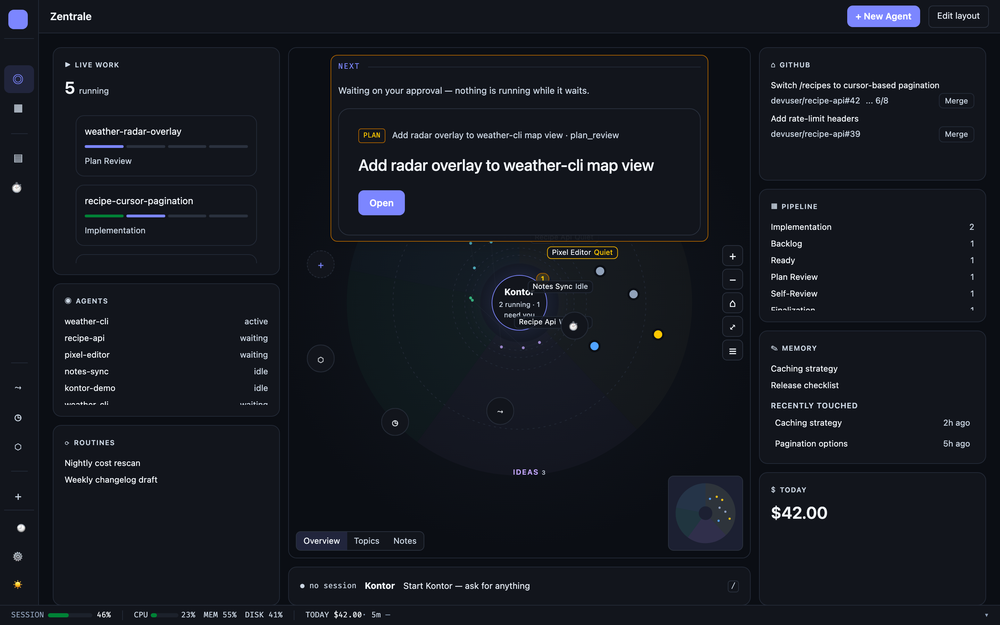
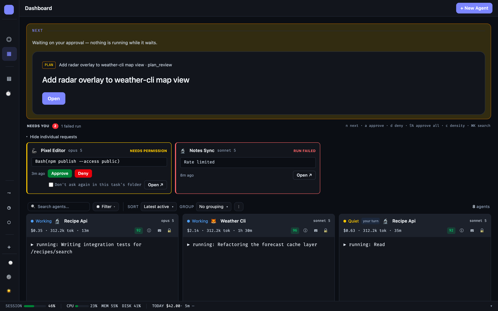
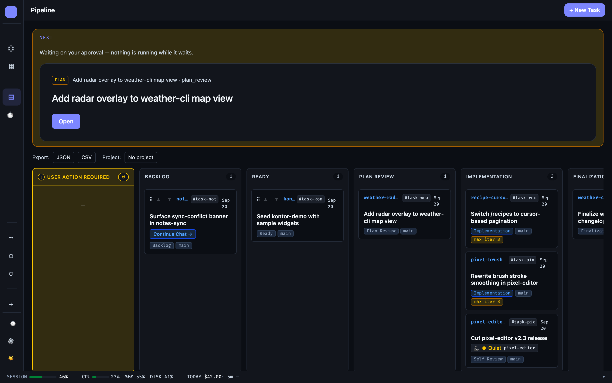
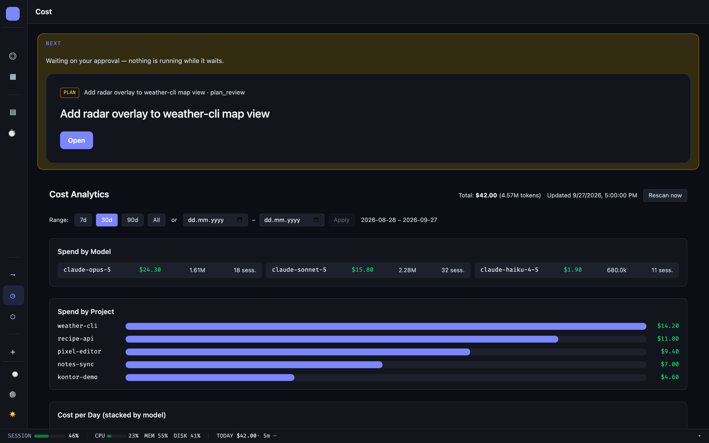
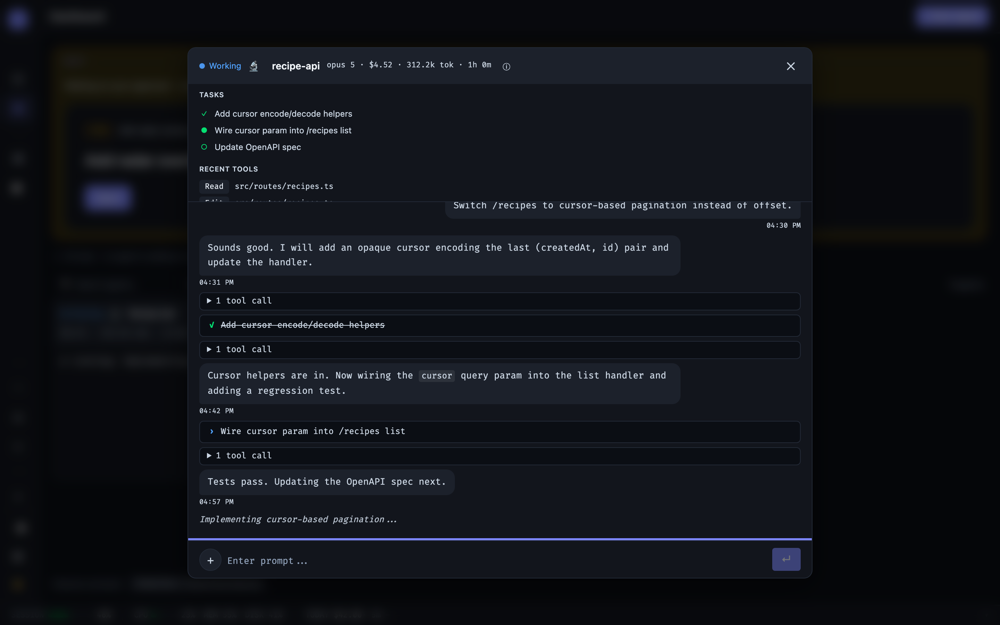

<div align="center">

# Kontor

**A real-time monitoring and control plane for locally running Claude Code agents.**

[](https://github.com/lx-wnk/kontor/actions/workflows/ci.yml)
[](https://github.com/lx-wnk/kontor/releases)
[](./LICENSE)
[](https://go.dev/)
[](https://vuejs.org/)
[](https://pnpm.io/)

</div>

**Kontor** — a Hanseatic merchants' word for the counting house from which a trading office ran its business. Here: the browser window from which you monitor and steer your agents.

<p align="center">
  
</p>

## Why Kontor

Most agent monitors require hooks or wrappers in every project. This one doesn't — it reads what Claude Code already writes to disk and watches the processes you already run.

- 🔌 **Zero-config monitoring** — scans processes and reads `CLAUDE_CONFIG_DIR` to discover agents; no per-project setup
- 🔁 **Task pipeline** — a state machine that spawns isolated git worktrees and runs multi-stage tasks
- 🎛️ **MCP control plane** — authenticate agents and grant scoped permissions from the dashboard
- 🔐 **Auth & permissions** — GitHub OAuth + JWT, scoped API keys, and a capability gate (see [Security](docs/guides/security.md) for detail)
- 🏠 **Local-first** — binds to `127.0.0.1`, no telemetry, no SaaS

## Quickstart

**Prerequisite:** [Claude Code](https://claude.ai/code) installed and run at least once. macOS and Linux only.

### Install

```sh
curl -fsSL https://raw.githubusercontent.com/lx-wnk/kontor/main/install.sh | sh
```

Or Homebrew (macOS):
```sh
brew install lx-wnk/tap/kontor
```

### First run

```sh
kontor serve
```

Open **http://127.0.0.1:13120** — any running Claude Code agents appear automatically.

For Docker, manual binary download, and all options, see [Install guide](docs/guides/install.md).

### Develop from source

Requires Go 1.26+, [Task](https://taskfile.dev), [air](https://github.com/air-verse/air), Node.js 22+, and [pnpm](https://pnpm.io/).

```bash
git clone https://github.com/lx-wnk/kontor.git
cd kontor
pnpm install
task dev            # hot-reload on :13120
```

See [CONTRIBUTING.md](./CONTRIBUTING.md) for the full dev setup and command reference.

## Screenshots

| | |
|---|---|
|  |  |
| Dashboard — live agent roster with the needs-you band | Pipeline — tasks across stages, each in its own worktree |
|  |  |
| Cost insights — token usage and spend by session | Agent detail — transcript, tasks, and permissions |

*Images generated from demo data. Regenerate with `pnpm screenshots`.*

## Features

**Zentrale & hub** — the default view: what needs you in the centre, live work, GitHub, pipeline, memory and today's cost around it. Every tile can be moved, resized, added or removed with **Edit layout**. The centre tile is a zoomable map of running agents and your Obsidian vault's notes on the same coordinate system. Notes are placed by your vault's folder hierarchy: each first-level folder is a category circle around the core, each second-level folder a project circle inside it, and every note sits in its project's circle, all sized in proportion to what they hold; older notes are drawn fainter. Agents sit on the rim of their project's circle: the Kontor project's **Vault folder** (Settings › Projects, as `category/project`) when it is set and exists, otherwise the project folder whose name matches the agent's project name, or failing that the folder it runs in (a Claude worktree under `.claude/worktrees/` counts as the repository it was cut from). The hub renders three semantic levels (Overview shows the circles; Topics labels every project and draws know-how links inside it; Notes labels notes and draws every link); each level switches at a zoom threshold. Notes display their kind (frontmatter `type`, folder path, or `note` by default). Agents without a matching vault folder sit on the rim of an `Other` circle, shown only while such agents run. Press `?` for a legend; the Unlinked / Stale toggle (also in the Memory tile) highlights know-how notes that nothing links to or that have not been touched for 90+ days.

**Kontor session** — one Claude session per installation that can read and steer Kontor through its task API; start it from the Zentrale or the `Cmd+K` field. If its Claude login expires, the tile offers **Log in**, which opens the session's terminal to run `/login`.

**Dashboard** — real-time agent roster over SSE (list, card, kanban) with tokens, cost, status and uptime; a needs-you band that approves or denies permission prompts in bulk; chat-style transcripts with tool groups and subagent badges; `Cmd+K` spotlight search.

**Live sessions** — agents spawned from the dashboard run interactively via tmux or a built-in pty broker; the agent modal has a real terminal tab and answers `AskUserQuestion` prompts inline. Commands that open a terminal picker (`/login`, `/model`, `/mcp`, …) open the terminal for you, and a picker left open is flagged as waiting in the terminal. The dashboard terminal attaches to pty-broker sessions only; for a tmux session, attach to its pane.

**Cloud sessions** — Monitor › Cloud sessions lists the claude.ai cloud sessions you started or imported, grouped by Claude account (the exact `CLAUDE_CONFIG_DIR` the spawner's CLI gets; a symlink and its target count as two accounts, and a spawner without one uses the server's explicit config dir when one is set, else the default account). Start a session with the *Start a cloud session* card (spawner, project, a folder of that project, and a description; the folder must be a stored project folder and its GitHub remote, at its current branch, is what the cloud session clones), import one by its `https://claude.ai/code/<id>` URL, send it a message, or remove it from Kontor; each account header shows whether it is signed in with claude.ai and, if not, the `claude auth login` command to run (only when the account is known to be signed out; if the check itself fails, the error is shown instead). The sign-in check times out after 15 s and a send after 60 s, so a send can take about 75 s. A start runs `claude --cloud "<description>"` under a pseudo-terminal (the CLI refuses `--cloud` without a terminal) in that folder, takes the session only from the CLI's `View:` line and gives up after 90 s, so it can take about 105 s with the sign-in check; only one start per spawner runs at a time (a second answers 409), and nothing is recorded when it fails. The description is passed as an argument, so it is visible in `ps` while the CLI runs, unlike a send's text, which goes over stdin. If Claude has not yet trusted the folder, the start fails with `claude does not trust this folder yet; …`: open the folder once with `claude` and accept the prompt. The session title is the first line of the description, at most 120 characters. A failed check or send is kept on the session as its last error and is never retried. The `claude` child runs with a minimal allow-listed environment, so it always uses the account's claude.ai login; `TZ`, most `LC_*` and the proxy and CA variables reach it only from the spawner's own environment. The view is in the side nav and the command palette, not in the hub. Messages go through your own `claude` CLI (`claude -p --cloud <id>`; a start uses `claude --cloud "<description>"`) under the spawner's account, so the text reaches Anthropic and Kontor never handles the login token. The CLI can send a message and nothing else: it cannot list cloud sessions, stop one or return the reply, so Kontor offers none of those. Open the session on claude.ai to read the reply or stop it. Removing a session deletes Kontor's row only.

**Routines (preview)** — Settings › Server › *Preview features* is off by default and needs no server restart: a Cloud sessions view open in the same browser window picks the switch up once it is saved in Settings, any other open view shows it the next time it is opened; while it is off, the routine API answers 404 and Cloud sessions replaces the Routines section with a one-line hint pointing to that setting. With it on, that section stores a claude.ai routine's fire URL (`https://api.anthropic.com/v1/claude_code/routines/trig_…/fire`) and its token for a Claude spawner, and fires it with optional text. The token is encrypted at rest and never shown again; Kontor makes the call itself (not the `claude` CLI), so the token and your text go to `api.anthropic.com`. The session the routine starts is added to Cloud sessions. This is a preview built on an experimental Anthropic endpoint and may change or go away. If a fire fails after Kontor connected to Anthropic (a timeout, a dropped connection, an unusable reply, or a session that could not be recorded), the run may still have started: the API answers 502 with `mayHaveStarted: true` and that routine's Fire button reads *Check claude.ai before firing again*. A timeout before a connection counts as not started. See [PRIVACY.md](PRIVACY.md) and [docs/guides/security.md](docs/guides/security.md).

**Pipeline & schedules** — tasks move through backlog, optional plan review, implementation, self-review and finalization, each stage a `claude` process in its own git worktree behind permission gates; per-stage engine, model and reasoning effort. A plan-usage gate blocks spawns when Claude's five-hour or seven-day rate-limit window exceeds a configurable threshold, resuming automatically after the window resets. A task whose work landed outside the pipeline (a hand-made PR or commit) is closed with **Mark Done** in its footer or `kontor tasks done <id> --ref owner/repo#123`; the reference lands in the audit log. Schedules fire recurring tasks from a cron expression (written in plain language, translated once).

**Insights** — workflow patterns, cost by project and session, and eval drift detection over past stage runs.

**Integrations** — MCP endpoint with scoped tokens, MCP applications such as mail that can be [limited to chosen spawners](docs/guides/mcp.md#limiting-an-application-to-spawners) (Claude accounts), Obsidian vault ([guide](docs/guides/obsidian.md)), GitHub pull requests ([guide](docs/guides/github.md)), pluggable LLM adapters (OpenAI-compatible, Ollama, `anthropic`), Web Push, webhook and email notifications. Codex, Gemini and Junie CLI agents can be monitored opt-in.

**Security & permissions** — GitHub OAuth + JWT, scoped API keys, and one capability gate (allow / deny / ask) for spawned agents, memory, Obsidian and GitHub access. See [Security](docs/guides/security.md).

The full reference lives in [`docs/`](docs/README.md).

## How it works

Kontor scans the processes you already run (`ps`/`lsof`) and reads the `CLAUDE_CONFIG_DIR` each one reports, discovering Claude Code sessions on disk. It tail-reads their `.jsonl` session logs, merges them with process metadata (PID, status, token cost), and broadcasts live updates to your browser over SSE. Agents answer back through an authenticated MCP endpoint that gates every tool by permission — GitHub OAuth for the dashboard, scoped bearer tokens for spawned agents — and you steer multi-stage tasks through git worktrees, capture memory, and answer permission prompts from the dashboard instead of their terminals.

See [Architecture overview](docs/architecture/overview.md) for the full stack, package layout, and data flow.

## Documentation

| | |
|---|---|
| [Install](docs/guides/install.md) | Download, Homebrew, Docker, build from source |
| [Configuration](docs/guides/configuration.md) | Every environment variable |
| [MCP endpoint](docs/guides/mcp.md) | Scopes, tools, connecting Claude |
| [Agent control](docs/guides/agent-control.md) | Channel control, spawn dialog, permissions |
| [Security](docs/guides/security.md) | Threat model, auth hardening, capability gate |
| [Desktop app](docs/guides/desktop.md) | macOS native shell |
| [Troubleshooting](docs/guides/troubleshooting.md) | Restart, locked out, common issues |
| [Obsidian vault](docs/guides/obsidian.md) | Local REST API setup and indexing |
| [GitHub integration](docs/guides/github.md) | Token, repository allow-list, merge from dashboard |
| [Architecture](docs/architecture/overview.md) | Stack, packages, data flow, pipeline |
| [Shell statusline](docs/guides/statusline.md) | PS1 integration |
| [Agent skills](docs/guides/agent-skills.md) | Registry-owned skills |

Full index: [`docs/`](docs/README.md).

## Contributing

Contributions welcome. See [CONTRIBUTING.md](./CONTRIBUTING.md) for setup, commands, and PR process.

## Security

See [SECURITY.md](./SECURITY.md) for hardening, defaults, and the threat model.

## License

[MIT](./LICENSE) © Alexander Wink
